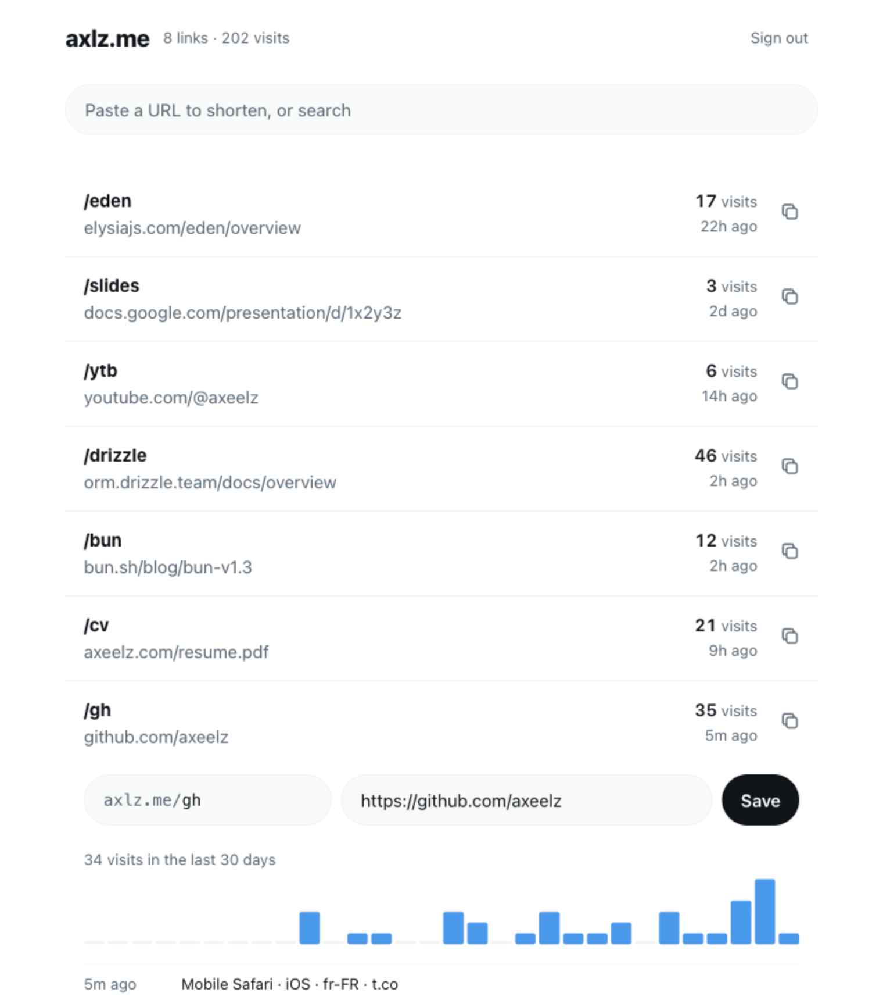

# axlz.me

My personal link shortener. Short links I can edit forever, and visit counts I can trust.

[Live page](https://axlz.me/about) · Bun · Elysia · Drizzle · Turso · React



## What it does

- **Paste, press enter.** A URL in the command bar becomes a short link, already in the clipboard. `https://example.com docs` picks the code.
- **Edit forever.** Redirects are temporary (302), so changing a destination is never hidden by a browser cache.
- **Count humans, not bots.** A visit is recorded only when it looks like a person opening the page:
  - the browser declares a page load (`Sec-Fetch-Mode: navigate`), which scripts and most crawlers don't send,
  - it is not a prefetch or a link preview (`Sec-Purpose`, `Purpose`),
  - the User-Agent is not a known bot ([isbot](https://github.com/omrilotan/isbot)),
  - the browser is not signed in to the admin, so my own clicks never count.

The rules live in [`src/visits.ts`](src/visits.ts) and are covered by [`test/visits.test.ts`](test/visits.test.ts).

## How it's built

One Bun process serves everything:

```
GET /:code        redirect, then record the visit without delaying the response
/api/*            Elysia routes, validated and typed end to end with Eden
/admin, /about    HTML pages bundled by Bun at startup (React for the admin, plain TS for About)
```

- **No framework server, no component library.** The admin is a single React file with plain CSS.
- **Stateless auth.** The session cookie holds an HMAC derived from the password. Changing the password signs every device out.
- **Migrations run at startup.** Drizzle applies anything new in `migrations/` before the server listens.
- **Zero config locally.** Without environment variables, the app uses a SQLite file and the password `admin`. Tests always use a throwaway database.

## Run it

```sh
bun install
bun dev            # http://localhost:3500/admin, password "admin"
bun test
bun run check      # types, lint, format
```

## Deploy

Production needs three variables (see [`.env.example`](.env.example)):

| Variable               | Purpose                        |
| ---------------------- | ------------------------------ |
| `TURSO_CONNECTION_URL` | Turso database URL             |
| `TURSO_AUTH_TOKEN`     | Turso token                    |
| `PASSWORD`             | Admin password, use a long one |

Every push to `main` runs the checks, builds a Docker image tagged with the commit, and restarts the container on the server, waiting for its health check. To roll back, run `TAG=<previous commit sha> docker compose up -d` on the server.

Schema changes go through `bun db:generate`, which writes a new SQL migration to commit.
