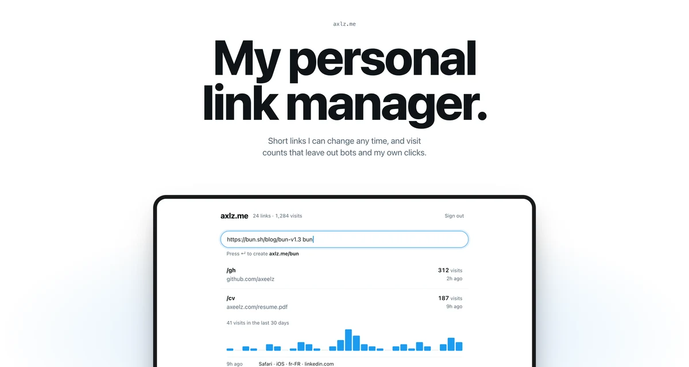

# axlz.me

My personal link shortener. I can change where a link points at any time, and the visit counts leave out bots, link previews and my own clicks.

[Live page](https://axlz.me/about) · Bun · Elysia · Drizzle · Turso · React

[](https://axlz.me/about)

## What it does

- **Paste, press enter.** A URL in the command bar becomes a short link and lands in the clipboard. Type a word after the URL to pick the code, like `https://example.com docs`.
- **Change a link any time.** Redirects are temporary (302). Browsers don't cache them, so a new destination works on the next click.
- **Only people count.** The server records a visit only when:
  - the browser says it's loading a page (`Sec-Fetch-Mode: navigate`), which scripts and most crawlers don't send,
  - it isn't a prefetch or a link preview (`Sec-Purpose`, `Purpose`),
  - the User-Agent isn't a known bot ([isbot](https://github.com/omrilotan/isbot)),
  - the browser isn't signed in to the admin, so my own clicks never count.

The rules are in [`src/visits.ts`](src/visits.ts), with tests in [`test/visits.test.ts`](test/visits.test.ts).

## How it's built

One Bun process serves everything:

```
GET /:code        redirect, then record the visit without delaying the response
/api/*            Elysia routes, with request validation and a typed client (Eden)
/admin, /about    HTML pages Bun bundles at startup (React for the admin, plain TS for About)
```

- **No framework, no component library.** The admin is one React file and plain CSS.
- **No session store.** The cookie holds an HMAC of the password. Change the password and every device signs out.
- **Migrations run at startup.** Drizzle applies anything new in `migrations/` before the server listens.
- **Nothing to configure locally.** Without environment variables, the app uses a SQLite file and the password `admin`. Tests run on an in-memory database.

## Run it

```sh
bun install
bun dev            # http://localhost:3500/admin, password "admin"
bun test
bun run check      # types, lint, format
```

## Deploy

Production needs three variables (see [`.env.example`](.env.example)). Without the database URL or the password, the app refuses to start.

| Variable               | Purpose                        |
| ---------------------- | ------------------------------ |
| `TURSO_CONNECTION_URL` | Turso database URL             |
| `TURSO_AUTH_TOKEN`     | Turso token                    |
| `PASSWORD`             | Admin password, use a long one |

Each push to `main` runs the checks, builds a Docker image tagged with the commit, and restarts the container on the server. The job fails if the new container doesn't pass its health check. To roll back, run `TAG=<previous commit sha> docker compose up -d` on the server.

For a schema change, edit `src/schema.ts` and run `bun db:generate`. It writes a SQL migration to commit.
